# Visio 可编辑绘图技能

本项目提供一个 Codex 技能，可根据 PNG 参考图、文字说明或已有 Visio 模板，生成可继续编辑的 Microsoft Visio 文件（`.vsdx`）。

技能通过 Windows 上的 Microsoft Visio COM 接口完成绘图。输出包含原生形状、连接线和文字，可在 Visio 中逐项修改。

<p align="center">
  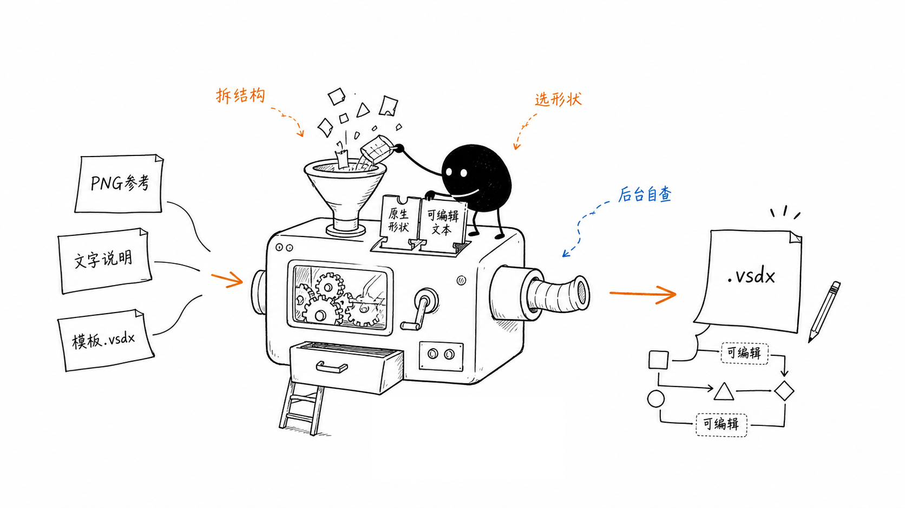
</p>

## 绘图示例

| 参考图 | Codex 生成的可编辑 Visio 图 |
| --- | --- |
| 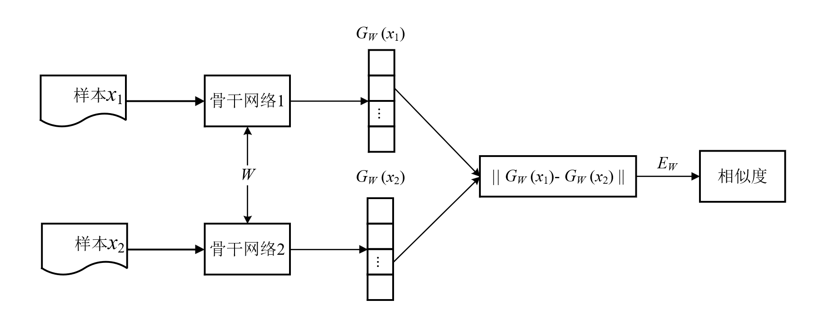 | 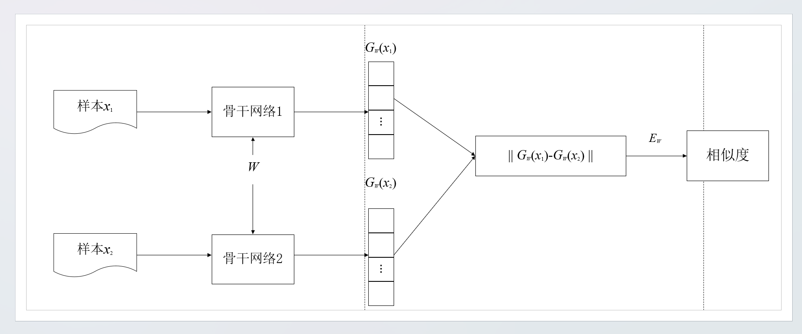 |
| 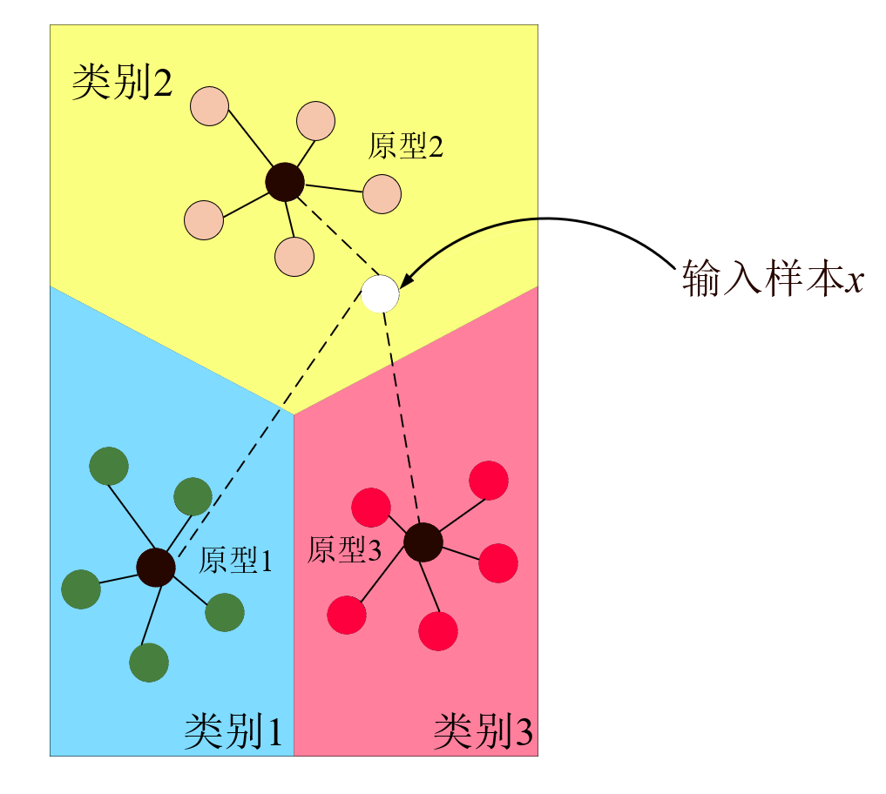 | 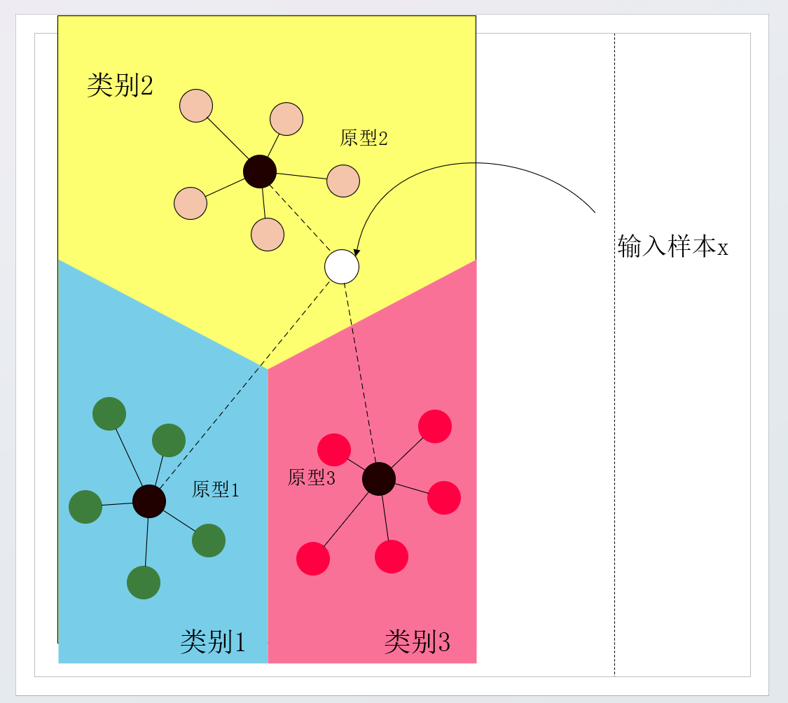 |
| 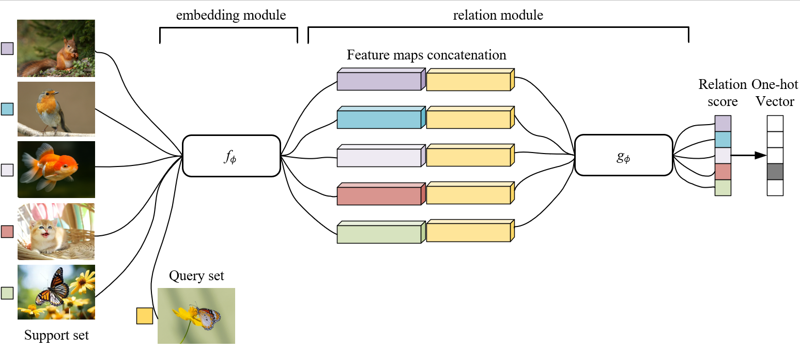 | 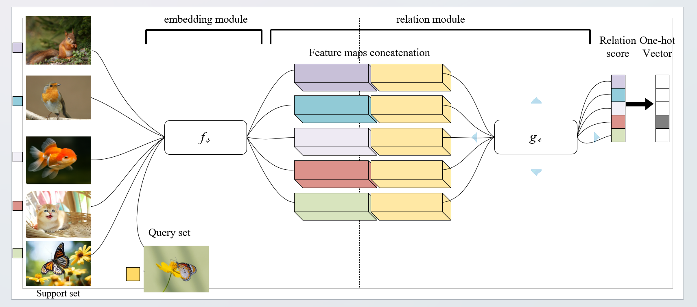 |
| 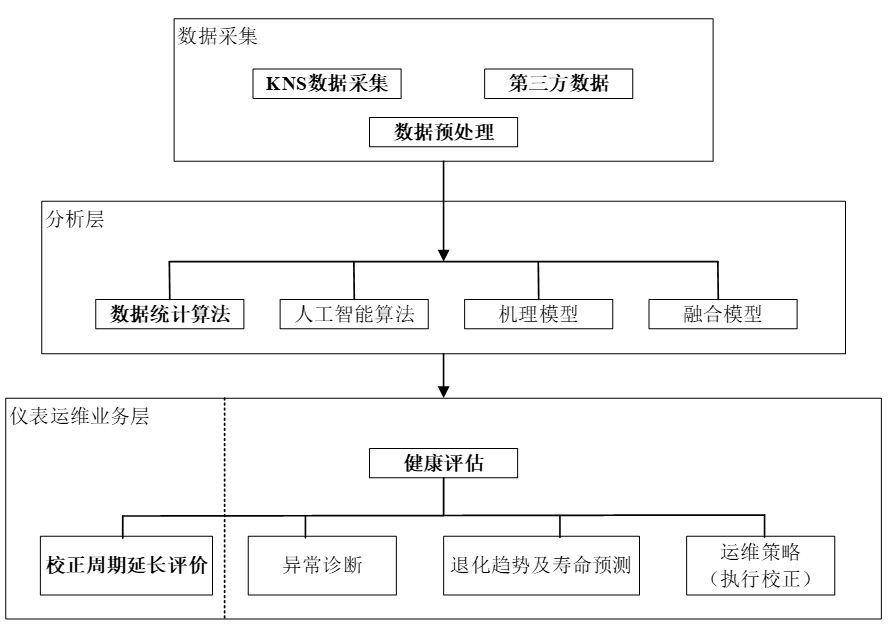 | 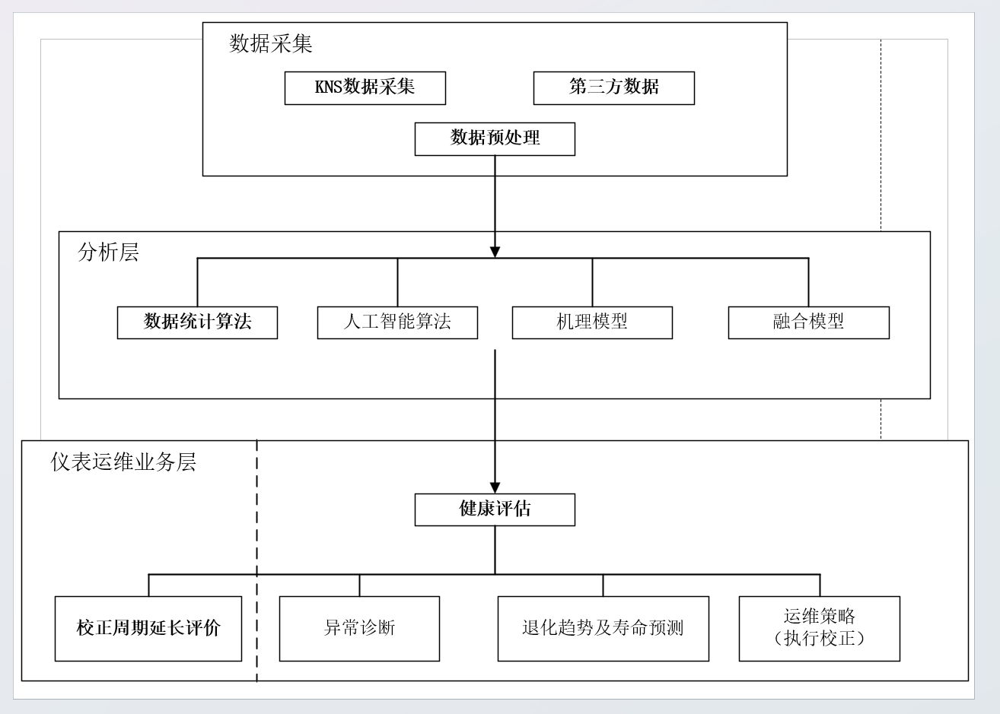 |
| 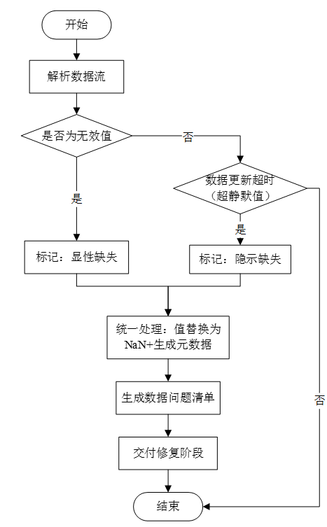 | 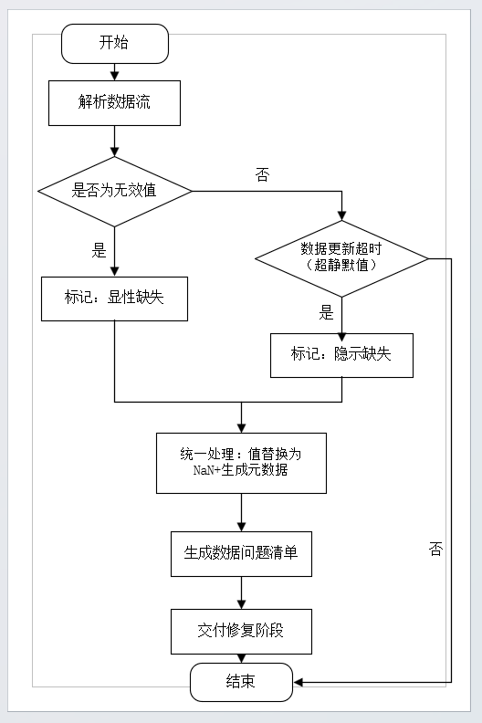 |

## 主要功能

- 根据参考图或文字说明生成可编辑的 `.vsdx` 文件。
- 默认使用独立、隐藏的 Visio 实例后台绘制，结束后关闭本任务文档并核验实例退出。
- 分别控制“显示绘制过程”和“完成后保留最终窗口”。
- 在同一文档中直接生成多页图册，避免依赖系统剪贴板。
- 记录实例归属、原始错误、保存、导出和清理结果，并提供独立的取消与超时监护。
- 优先使用 Visio 原生模具、母版、形状、连接线和可编辑文字。
- 支持绘制前的布局检查，以及数学标签的字体、斜体、上下标等格式。
- 仅在明确要求时导出 PNG 预览。

## 运行环境

- Windows，以及本机已安装的 Microsoft Visio。
- Windows PowerShell 5.1：执行实际 COM 绘图任务，使用 STA 模式。
- PowerShell 7：可用于启动技能脚本；绘图进程仍由脚本调用 Windows PowerShell 5.1。
- Python 3：用于布局检查和参考图裁剪辅助脚本。
- Pillow：仅在使用 `crop_reference_regions.py` 裁剪图片时需要。

## 技能目录

可安装的技能包位于：

```text
skill/visio-template-drawing/
```

主要文件和目录：

| 路径 | 用途 |
| --- | --- |
| `skill/visio-template-drawing/SKILL.md` | 技能说明和执行规则 |
| `skill/visio-template-drawing/agents/openai.yaml` | 技能界面配置 |
| `skill/visio-template-drawing/scripts/` | 绘图、导出、检查和清理脚本 |
| `skill/visio-template-drawing/references/` | 绘图方案格式、接口和恢复说明 |
| `skill/visio-template-drawing/examples/` | 可运行的绘图方案示例 |

## 安装

将下面这段话发给 Codex，让它完成安装：

> 请从 https://github.com/zxc-heu/visio-template-drawing-skill 安装 `skill/visio-template-drawing` 技能到当前 Codex 使用的技能目录。安装前检查是否已有同名技能；如有，先比较并保留本地修改，再同步需要更新的文件。完成后检查技能是否可识别，并告诉我是否需要重启 Codex。

## 如何使用

安装完成后，在 Codex 对话中说明要画什么，并明确使用 `visio-template-drawing` 技能。日常使用不需要自己编写绘图方案或输入 PowerShell 参数。

### 根据参考图绘制

上传参考图后，可以这样说：

> 使用 visio-template-drawing 技能，把这张参考图重绘为可编辑的 Visio 文件。保留文字、连接关系和整体布局，保存到桌面，文件名为“流程图_codex.vsdx”。

### 根据文字说明绘制

> 使用 visio-template-drawing 技能，绘制“数据采集 → 数据清洗 → 模型计算 → 结果展示”的流程图。每一步使用独立形状，箭头连接，保存到桌面。

### 生成多页图册

> 使用 visio-template-drawing 技能，将这八张参考图分别绘制为八个页面，按上传顺序放入同一个可编辑的 Visio 文件，保存到桌面。

### 选择显示方式

在请求末尾加一句即可；不加时默认后台绘制并关闭。

| 你的要求 | 对应参数 | 实际行为 |
| --- | --- | --- |
| 后台绘制，完成后关闭 | 默认 | 全程隐藏，保存后清理所属实例 |
| 让我看到绘制过程，完成后关闭 | `-Visible` | 显示过程，完成后关闭 |
| 后台绘制，完成后打开最终图并保留 | `-KeepOpen` | 全部成功后显示并保留最终文档 |
| 显示绘制过程，完成后保留最终图 | `-Visible -KeepOpen` | 显示过程，全部成功后保留最终文档 |
| 另外导出每一页的 PNG 预览 | `-PreviewDirectory` | 按页导出 PNG；VSDX 仍是可编辑源文件 |

表中的参数供手动调用脚本时参考；在对话里直接使用左侧的中文说法即可。`-KeepOpen` 仅在保存及所请求的导出全部成功后生效。

### 输出位置

- 提供本地输入文件时：默认保存到输入文件旁，命名为 `原文件名_codex.vsdx`。
- 直接粘贴图片且没有本地路径时：默认保存到桌面，使用描述性的文件名并以 `_codex.vsdx` 结尾。
- 明确指定路径或文件名时：以你的要求为准。
- 仅提供文字说明时：建议明确指定位置；当前技能没有为这种情况规定统一的默认目录。

## 常见问题

### 需要先打开 Visio 吗？

不需要。安装好 Visio 后，技能会创建属于当前任务的实例。你已打开的文档不作为后台任务的绘图目标。

### 绘图时还能使用其他软件、复制粘贴吗？

默认后台流程不使用鼠标、键盘焦点或系统剪贴板。已完成真实的并行点击、输入和复制粘贴验收。如果某项操作必须借助前台界面，应在执行前说明。选择可见模式后，不能将后台模式的无干扰承诺直接套用到窗口显示过程。

### 输出是真的可编辑吗？

是。绘图使用原生形状、文字和连接线，已验证对象编辑和连接粘附。PNG 仅用于预览；继续编辑应打开 `.vsdx` 文件。

### 为什么默认没有 PNG？

默认交付可编辑的 `.vsdx`。需要预览时，在请求中加上“另外导出每一页的 PNG 预览”即可。

### 为什么使用 PowerShell 5.1，而不是直接使用 PowerShell 7 绘图？

这是当前实现的兼容性选择。该工作流曾遇到 COM 数值参数绑定差异，完整的绘图、异常清理和中断恢复验收是在 Windows PowerShell 5.1 下完成的。PowerShell 7 可以启动入口脚本，但实际绘图进程固定使用 5.1。

STA 指“单线程单元”，是一种 COM 线程模型；PowerShell 7 在 Windows 上同样支持 STA，因此 STA 本身不是选择 5.1 的理由。目前尚未完成由 PowerShell 7 直接执行全部 COM 绘图的兼容性验收。

### 任务失败后，会不会留下空白窗口或丢失我原来的文档？

脚本按实例归属执行关闭和退出核验，处理绘图异常、保存失败、导出失败、取消及超时；已用受控的未保存文档验证隔离。若导出失败发生在保存成功之后，已保存的 VSDX 会保留。

强制结束进程或断电可能使常规清理无法执行。恢复流程只处理归属已确认、任务已结束且从未显示过的遗留实例；曾显示的或归属不明的实例需要核查。不能批量结束所有 `VISIO.EXE`，也不能仅凭输出文件存在就认定清理成功。

### 为什么提示输出文件已存在？

入口脚本拒绝覆盖已有输出，以保护原文件。请改用新的文件名；如需修改已有图，应明确说明输入文件和另存位置。

### 能把多个现有 VSDX 文件直接合并吗？

当前支持从多个绘图方案直接生成多页文档；尚不支持将任意已有 VSDX 的页面直接导入，也不支持跨页连接。应在开始任务前区分“按参考图生成图册”和“合并已有 Visio 文件”。

## 验收测试

以下测试会创建本地测试文件。添加 `-IncludeVisible` 时，会主动打开受控的测试窗口。

```powershell
powershell -NoProfile -STA -File skill\visio-template-drawing\scripts\test_visio_lifecycle.ps1 `
  -OutputDirectory .\outputs\本轮流程验收 -IncludeVisible
powershell -NoProfile -STA -File skill\visio-template-drawing\scripts\test_visio_interruptions.ps1 `
  -OutputDirectory .\outputs\本轮中断验收
```

测试输出和日志仅保存在本地。后台绘制期间的真实鼠标、键盘和剪贴板使用，需要人工并行操作验收，不能用静态检查代替。

## 更新说明：2026-09-21

- 为绘图、图册、导出和探测统一了实例归属、文档登记、原始错误记录、COM 引用释放和退出核验。
- 增加无需剪贴板的多页方案、可选模板、独立的显示与保留选项、取消、超时监护及限定范围的遗留恢复。
- 已在 Visio 16 和 Windows PowerShell 5.1 STA 环境完成验收；PowerShell 7.6 启动入口也已通过。
- 实测覆盖连续两轮单页及八页绘图、原生对象编辑和连接粘附、真实保存与导出失败、已有未保存文档隔离、窗口显示与保留、文件锁、取消、工作进程及启动进程被终止、超时。其他软件的并行操作已由用户参与确认。
- 尚未验证的范围包括 PowerShell 7 直接执行完整 COM 工作流、机器断电，以及所有第三方加载项和模态弹窗故障。任意已有 VSDX 页面导入及跨页连接不在当前支持范围内。

## 公开范围

公开技能以 `skill/visio-template-drawing/` 和本说明为准。本地测试输出、一次性调试脚本、生成预览、会话记录及私人材料不纳入发布。

## 许可证

采用 MIT 许可证，详见 [LICENSE](LICENSE)。
